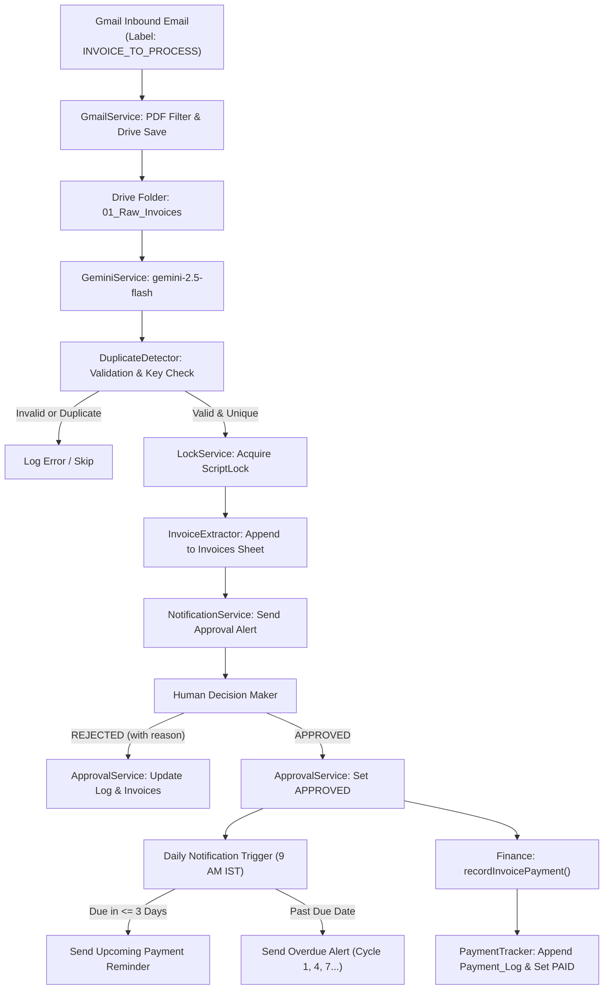

# System Architecture & Technical Design

## Intelligent Invoice Processing & Payment Tracker

### 1. Executive Architecture Overview

The **Intelligent Invoice Processing & Payment Tracker** is an enterprise-grade automated accounts payable platform built on the Google Workspace ecosystem, Google Apps Script V8 runtime, and Google Gemini Multimodal Generative AI.

It orchestrates a complete lifecycle:
```
Gmail Ingestion ──> Drive Storage ──> Gemini AI Extraction ──> Rule Validation
       │
       ▼
Duplicate Guard ──> Sheets DB ──> Approval Service ──> Payment Tracker ──> Notification Engine
```

---

## 2. Core Architectural Components

### A. Gmail Ingestion Layer (`GmailService.gs`)
- **Role**: Continuously monitors the Gmail mailbox for threads bearing the label `INVOICE_TO_PROCESS`.
- **Filtering & Sanitization**: Inspects incoming messages, skips non-PDF attachments, normalizes file names to remove illegal characters, and enforces idempotency via Gmail Message ID hashing.
- **Isolation**: Places ingested raw PDFs into the designated `01_Raw_Invoices` Google Drive folder.

### B. Cloud Storage & Hierarchy Layer (`DriveService.gs`)
- Organizes the document lifecycle across 4 isolated Drive directories:
  1. `01_Raw_Invoices` (`1nuWe1WSCNroV_YT1D1WNA7THTWrVk5fB`): Newly ingested vendor files.
  2. `02_Processed_Invoices` (`1tTZ5OWiGoRqUHXFPgxTn11X54ZFPK7wL`): Extracted and confirmed invoices.
  3. `03_Approval_Records` (`1mqtBXnBjKTkGIb45tErjrJbIJvaNom9n`): Exported decision records.
  4. `04_Reports` (`1rFecjahJXJLfnkSjDCThDiGKMunAMA2Z`): Auditing and reconciliations.

### C. Multimodal AI Extraction Layer (`GeminiService.gs`)
- **Model**: `gemini-2.5-flash`
- **Methodology**: Sends binary PDF content as Base64 payload alongside a strict zero-shot extraction system prompt.
- **Structured Schema Enforced**:
  - `invoice_id`, `vendor_name`, `vendor_email`, `invoice_date`, `due_date`, `currency`, `subtotal`, `tax`, `total_amount`, `po_number`, `extraction_confidence`.
- **Fault-Tolerance**: Exponential backoff retry engine handling transient HTTP 429, 500, 502, 503, and 504 errors.

### D. Business Validation & Duplicate Prevention (`DuplicateDetector.gs`)
- **Validation Engine**:
  - Mandatory field existence check.
  - Strict ISO 8601 date parsing (`YYYY-MM-DD`).
  - Chronological validation (`due_date >= invoice_date`).
  - 3-letter currency code validation (`^[A-Z]{3}$`).
  - Strict mathematical formula validation: $|(\text{subtotal} + \text{tax}) - \text{total\_amount}| \le 0.01$.
  - Minimum AI extraction confidence threshold ($\ge 0.70$).
- **Deterministic Duplicate Key**:
  $$\text{Key} = \text{lower}(\text{vendor\_name}) \parallel "|" \parallel \text{lower}(\text{invoice\_id})$$
- Evaluated against column 13 of the `Invoices` sheet with ScriptLock concurrency protection.

### E. Database Persistence Layer (`InvoiceExtractor.gs`)
- **Target**: Google Sheets Database (`1PJuZp1RDdUE7Be7KwOg0T2xKTM8Qnw_ku8lCFpkBTjs`).
- **Concurreny Control**: Acquires an exclusive `ScriptLock` (10,000 ms timeout) before row calculation and write operations to eliminate race conditions.
- **Schema Alignment**: 18 fixed columns preserving data integrity and audit metadata.

### F. Multi-Tier Approval Workflow (`ApprovalService.gs`)
- Manages state transitions:
  $$\text{PENDING} \longrightarrow \{\text{APPROVED}, \text{REJECTED}\}$$
- Requires explicit justification for any rejection.
- Appends immutable audit entries to `Approval_Log` recording approver email, decision, timestamp, and reasoning.

### G. Payment Tracking & Overdue Monitoring (`PaymentTracker.gs`)
- Preconditions: Only `APPROVED` and `UNPAID` invoices can transition to `PAID`.
- Requires mandatory payment date and reference number (wire/check/transaction ID).
- Logs disbursements to `Payment_Log`.
- Computes calendar-based overdue status against configured timezone (`Asia/Kolkata`).

### H. Automated Notification Engine (`NotificationService.gs`)
- **Strict Administrator Route**: All emails route strictly to `CONFIG.NOTIFICATION_SETTINGS.ADMIN_EMAIL` (`anjalids989@gmail.com`). Real vendors are never contacted.
- **Idempotency Mechanism**:
  - Uses event keys in `Notification_Log` (`APPROVAL_PENDING_<id>`, `INVOICE_APPROVED_<id>`, `UPCOMING_<id>`, `OVERDUE_<id>_CYCLE_<n>`).
  - Checks state (`SENT` or `SENDING`) before triggering `MailApp.sendEmail`.
- **Upcoming Payment Window**:
  - Reminds when $0 \le \text{daysUntilDue} \le 3$.
  - Idempotency guarantees exactly one reminder, protecting against missed triggers or late approvals.
- **Overdue Intervals**: Recurring alerts on Day 1, 4, 7, 10, etc.

---

## 3. Data Flow Diagram



---

## 4. Security & Compliance Architecture

1. **Zero Secret Hardcoding**: Secrets (`GEMINI_API_KEY`) reside exclusively in Apps Script `ScriptProperties`.
2. **Execution Sandboxing**: No external network endpoints are contacted except official Google APIs (`generativelanguage.googleapis.com`, `script.google.com`, `sheets.googleapis.com`, `drive.googleapis.com`).
3. **No External Vendor Emailing**: Vendor emails extracted from PDFs are recorded for indexing only; all email communications are programmatically locked to the administrator email.
4. **Idempotency by Design**: Dual-phase logging (`SENDING` -> `SENT`/`FAILED`) ensures zero duplicate email spam even if execution quotas interrupt running tasks.
